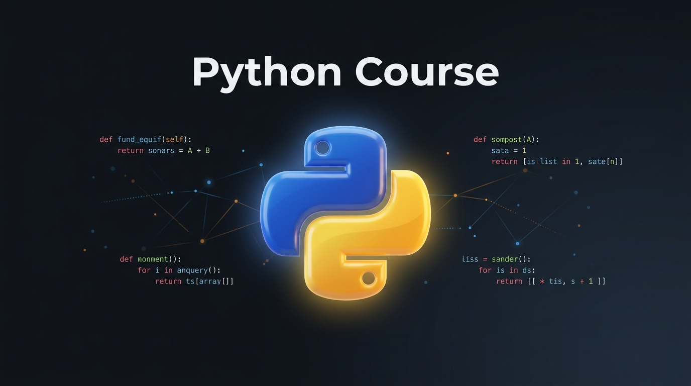

# Python · Блок «Разработка на Python»

Учебные материалы курса: теория и домашние задания по каждому уроку.

Блок рассчитан примерно на 2 месяца, по 14 уроков в месяц — всего 28 уроков.

## Как пользоваться

1. Откройте папку нужного месяца, затем папку урока.
2. Прочитайте `lesson.md` — там теория урока.
3. Откройте `homework.md` — там задания. Код пишите у себя на компьютере
   в отдельном файле, этот файл — только список заданий.

## Месяцы

- [Месяц 1 — уроки 1–14](month-1/)
- [Месяц 2 — уроки 15–28](month-2/)
