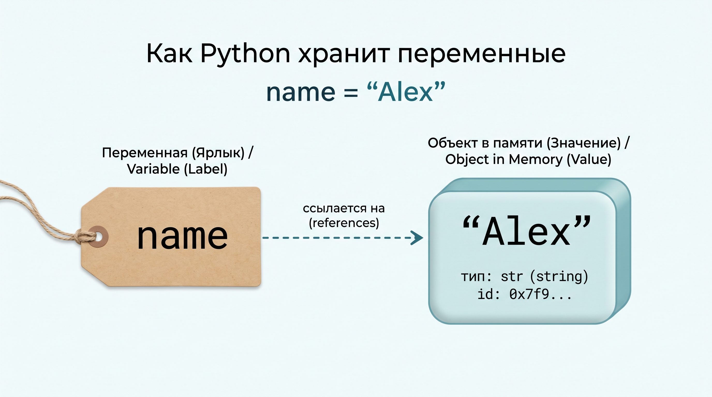

# Урок 1. Первые шаги в Python

На этом уроке вы напишете свои первые программы на Python, научитесь выводить данные на экран, выполнять математические вычисления, сохранять информацию в переменные и запрашивать данные у пользователя.

## Цель урока

Понять, как компьютер выполняет код на Python, освоить команду вывода `print()`, базовые математические операции, концепцию переменных и команду ввода `input()`.

## План урока

1. Что такое Python
2. print() — вывод на экран (куда Python выводит результат)
3. Математические операции: +, -, *, /, //, **, %
4. Переменные
5. input() — ввод данных с клавиатуры

## Что такое Python

Python — это язык программирования. Представьте переводчика: вы говорите ему понятными словами, что нужно сделать, а он передаёт это компьютеру. Мы пишем инструкции — команды, — а Python заставляет компьютер их выполнять.

Запомните главное: Python понимает всё буквально. Он сделает ровно то, что вы написали. Поэтому если что-то не работает — это не Python «не понял», это мы где-то ошиблись: либо в самой идее, либо просто опечатались.

А ещё Python удобен тем, что его легко читать: команды похожи на обычные слова.

## print() — вывод на экран

Команда `print()` выводит информацию на экран. Вся информация отображается в консоли (терминале) — это окно вывода программы.

Чтобы вывести текст, его обязательно нужно заключить в кавычки (одинарные или двойные):

```python
print("Привет, мир!")
print('Изучаем Python')
```

Если убрать кавычки у текста, Python решит, что это название команды или переменной, и выдаст ошибку.

Числа пишутся без кавычек:

```python
print(42)
print(-15)
```

Через `print()` можно выводить сразу несколько значений. Для этого перечислите их через запятую. Python автоматически выведет их через пробел:

```python
print("Мне", 25, "лет")
```

## Математические операции

Python отлично работает как калькулятор. Вы можете вычислять выражения прямо внутри `print()`:

- `+` — сложение: `print(10 + 5)` (выведет 15)
- `-` — вычитание: `print(20 - 7)` (выведет 13)
- `*` — умножение: `print(4 * 6)` (выведет 24)
- `/` — деление: `print(15 / 3)` (выведет `5.0`)
- `//` — целочисленное деление (деление нацело): `print(7 // 2)` (выведет 3)
- `%` — остаток от деления: `print(7 % 2)` (выведет 1)
- `**` — возведение в степень: `print(2 ** 4)` (выведет 16)

Обратите внимание на деление `/`: результат обычного деления в Python всегда получается числом с плавающей точкой (дробным), даже если делилось нацело (`10 / 2` даст `5.0`).

Если нужно отбросить дробную часть, используйте целочисленное деление `//`:
- `7 // 2` даст `3`, потому что число 2 помещается в 7 ровно три раза.
- `7 % 2` вернет остаток `1` (так как `7 = 3 * 2 + 1`).

Порядок выполнения операций — классический школьный: сначала возведение в степень, затем умножение и деление, в конце — сложение и вычитание. Изменить порядок можно круглыми скобками:

```python
print(2 + 2 * 2)    # выведет 6
print((2 + 2) * 2)  # выведет 8
```

## Переменные

Переменная — это имя, которое мы даём значению в памяти программы, чтобы обращаться к нему дальше.

В Python переменная работает как **ярлык (бирка с именем)**, который ссылается на объект со значением в памяти.



Чтобы прикрепить ярлык к значению, используют знак равно `=` (оператор присваивания):

```python
name = "Alex"
age = 20
```

Когда выполняется строчка `name = "Alex"`:
1. В памяти компьютера создаётся объект со значением `"Alex"`.
2. Переменная `name` становится ярлыком, который ссылается на этот объект.

Теперь к этим данным можно обращаться по имени переменной:

```python
print(name)
print(age)
print("Привет,", name)
```

Обратите внимание: имя переменной пишется **без кавычек**. Если написать `print("name")`, программа выведет просто слово `name`, а не значение, на которое указывает переменная.

Если присвоить переменной новое значение, ярлык просто перевешивается на новый объект:

```python
age = 20
age = 25
print(age)  # выведет 25
```

### Правила названий переменных:
1. Только латинские буквы, цифры и знак подчеркивания `_`.
2. Название не может начинаться с цифры (`user1` — можно, `1user` — ошибка).
3. В Python принято писать названия строчными буквами, разделяя слова нижним подчеркиванием (`snake_case`): `user_name`, `total_price`.
4. Давайте переменным понятные имена. Переменная `city` понятнее, чем `x` или `c`.

## input() — ввод данных с клавиатуры

Команда `input()` позволяет программе запросить данные у пользователя с клавиатуры.

Когда выполнение доходит до `input()`, программа останавливается и ждет, пока пользователь введет текст и нажмет Enter. Введенный текст сохраняют в переменную:

```python
user_name = input("Как вас зовут? ")
print("Привет,", user_name)
```

Текст внутри скобок `input("...")` — это подсказка, которую увидит пользователь перед вводом.

С помощью `input()` можно запрашивать несколько значений подряд и использовать их в программе:

```python
name = input("Ваше имя: ")
city = input("Из какого вы города? ")

print("Пользователь:", name)
print("Город проживания:", city)
```

## Домашка

Задания — в файле [homework.md](homework.md).
Код пишите у себя на компьютере в отдельном файле.
