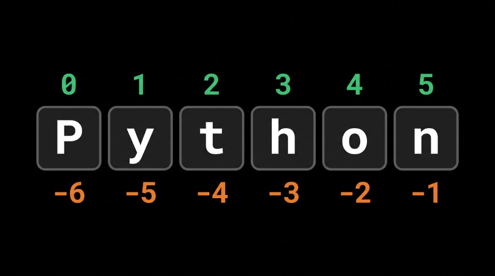

# Урок 3. Строки: индексация, срезы и форматирование

На этом уроке вы узнаете, как устроены строки изнутри, научитесь извлекать из них отдельные буквы и целые части, проверять наличие символов и красиво оформлять вывод с помощью f-строк.

## Цель урока

Понять, что строка — это упорядоченная последовательность символов. Научиться измерять длину строки командой `len()`, обращаться к отдельным буквам по положительным и отрицательным индексам, извлекать подстроки через базовые срезы (`[start:end]`), использовать операции `+`, `*`, `in`, `not in` и применять f-строки для удобного форматирования текста.

## План урока

1. Длина строки: функция `len()`
2. Индексация строк (положительные и отрицательные индексы)
3. Базовые срезы строк: `[start:end]`, `[start:]`, `[:end]`
4. Операции со строками: `+`, `*`, `in`, `not in`
5. Форматирование строк: f-строки (`f"..."`)

---

## 1. Длина строки: функция len()

Строка в Python состоит из отдельных символов: букв, пробелов, знаков препинания и цифр. 

Чтобы узнать, сколько всего символов содержится в строке, используют встроенную команду `len()` (от английского *length* — длина):

```python
word = "Python"
print(len(word))  # Выведет: 6

phrase = "Привет, мир!"
print(len(phrase))  # Выведет: 12 (пробел и восклицательный знак тоже считаются символами)
```

Функция `len()` возвращает целое число (`int`).

---

## 2. Индексация строк

В языках программирования элементы упорядоченных данных нумеруются с помощью чисел — этот процесс называется **индексацией**. 

В Python строки являются **упорядоченной последовательностью**. Это значит, что каждый символ в строке занимает своё строго определённое место и имеет порядковый номер — **индекс**. Зная индекс, мы можем обратиться к любому конкретному символу строки.

> [!IMPORTANT]
> Самое главное правило: в Python индексация **строго начинается с нуля (`0`)**, а не с единицы!

Чтобы получить символ по индексу, после имени переменной ставят квадратные скобки `[]`, а внутри указывают номер:

```python
word = "Python"

print(word[0])  # Выведет: P (самый первый символ)
print(word[1])  # Выведет: y
print(word[2])  # Выведет: t
```

### Отрицательные индексы

Индексы строк также могут быть указаны **отрицательными числами**. Отрицательная индексация идёт с конца строки:
- `-1` — это всегда самый последний символ строки;
- `-2` — предпоследний, и так далее.

Взгляните на схему:



Положительные индексы (сверху) нумеруют строку слева направо от `0` до `5`. Отрицательные индексы (снизу) нумеруют справа налево от `-1` до `-6`.

Пример в коде:

```python
word = "Python"

print(word[-1])  # Выведет: n (последняя буква)
print(word[-2])  # Выведет: o (предпоследняя буква)
print(word[-6])  # Выведет: P (первая буква с конца)
```

### Ошибка IndexError

Если попытаться запросить индекс, которого нет в строке, программа остановится с ошибкой:

```python
word = "Python"
print(word[6])  # Ошибка!
```

Вывод в консоли:
```text
IndexError: string index out of range
```
*(«Индекс вышел за пределы диапазона строки»)*. 

В слове `"Python"` всего 6 букв, но так как отсчёт начинается с `0`, последний символ имеет индекс `5`. Индекса `6` не существует.

---

## 3. Базовые срезы строк (Slices)

Индексация позволяет достать только одну букву. А что делать, если нужно вырезать часть слова или целое слово из предложения? Для этого в Python используют **срезы** (*slices*).

Срез записывается через двоеточие внутри квадратных скобок: `строка[start:end]`.

> [!WARNING]
> Важнейшее правило срезов: символ с индексом `start` **включается** в срез, а символ с индексом `end` — **НЕ включается** (срез идёт строго до него).

Разберём основные варианты на примере слова `"Python"`:

### 1. Срез от одного индекса до другого: `var[start:end]`
```python
word = "Python"

# Берём символы с индекса 0 до 2 (символ 2 не включается)
print(word[0:2])  # Выведет: Py

# Берём символы с индекса 1 до 4 (символ 4 не включается)
print(word[1:4])  # Выведет: yth
```

### 2. Срез от начала строки: `var[:end]`
Если опустить начальный индекс `start`, Python начнёт срез с самого первого символа (с индекса `0`):
```python
word = "Python"

print(word[:2])  # То же самое, что word[0:2] -> Py
print(word[:4])  # Выведет: Pyth
```

### 3. Срез до самого конца строки: `var[start:]`
Если опустить конечный индекс `end`, срез пойдёт от указанного индекса до самого конца строки включительно:
```python
word = "Python"

print(word[2:])  # От индекса 2 и до конца -> thon
print(word[4:])  # От индекса 4 и до конца -> on
```

---

## 4. Операции со строками: +, *, in, not in

Со строками в Python можно выполнять удобные операции:

### Сложение строк (`+`) — конкатенация
Объединяет несколько строк в одну:
```python
greeting = "Привет, " + "мир!"
print(greeting)  # Привет, мир!
```

### Умножение строки на число (`*`) — повторение
Дублирует строку указанное количество раз:
```python
line = "-" * 10
print(line)  # ----------

laugh = "ха" * 3
print(laugh)  # хахаха
```

### Проверка вхождения: `in` и `not in`
Оператор `in` проверяет, входит ли определённая подстрока внутрь строки. Результатом всегда будет булево значение — `True` (если входит) или `False` (если нет):

```python
word = "Python"

print("th" in word)   # True (сочетание 'th' есть внутри слова)
print("on" in word)   # True
print("z" in word)    # False (буквы 'z' в слове нет)
print("p" in word)    # False (в слове буква 'P' заглавная, регистр важен!)
```

Оператор `not in` работает наоборот — проверяет, что подстроки **нет** внутри строки:
```python
word = "Python"

print("z" not in word)   # True (да, буквы 'z' действительно нет)
print("Py" not in word)  # False (подстрока 'Py' есть)
```

---

## 5. Форматирование строк: f-строки

В предыдущих уроках, чтобы вывести переменные вместе с текстом, приходилось ставить запятые в `print()` или переводить числа через `str()` и склеивать плюсами:

```python
name = "Анна"
age = 20

# Старый неудобный способ:
print("Привет, меня зовут " + name + ", и мне " + str(age) + " лет.")
```
Это долго писать и легко запутаться в пробелах и плюсах.

В современном Python для красивого вывода используют **f-строки** (*formatted strings*). 

Чтобы строка стала f-строкой, перед открывающей кавычкой ставят букву `f` (маленькую или большую). После этого прямо внутри текста в фигурных скобках `{}` можно вызывать переменные или даже писать математические выражения:

```python
name = "Анна"
age = 20

# Удобный способ с f-строкой:
message = f"Привет, меня зовут {name}, и мне {age} лет."
print(message)
```

Внутри фигурных скобок можно сразу выполнять вычисления:
```python
price = 150
count = 3
print(f"Итого к оплате: {price * count} руб.")  # Итого к оплате: 450 руб.
```

---

## Домашка

Задания — в файле [homework.md](homework.md).
Код пишите у себя на компьютере в отдельном файле.
