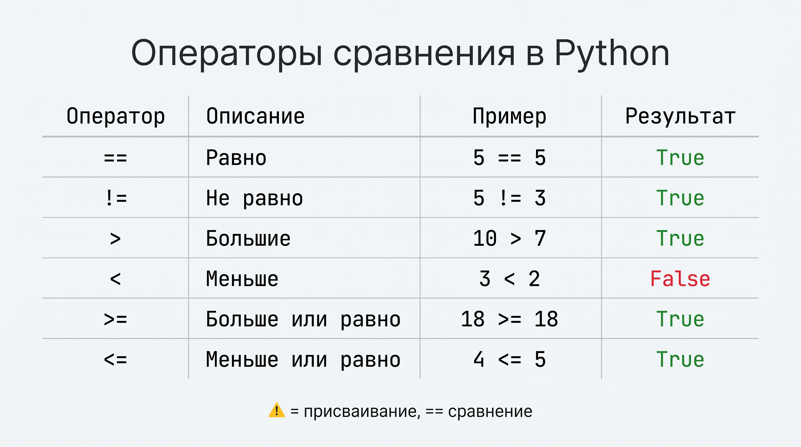
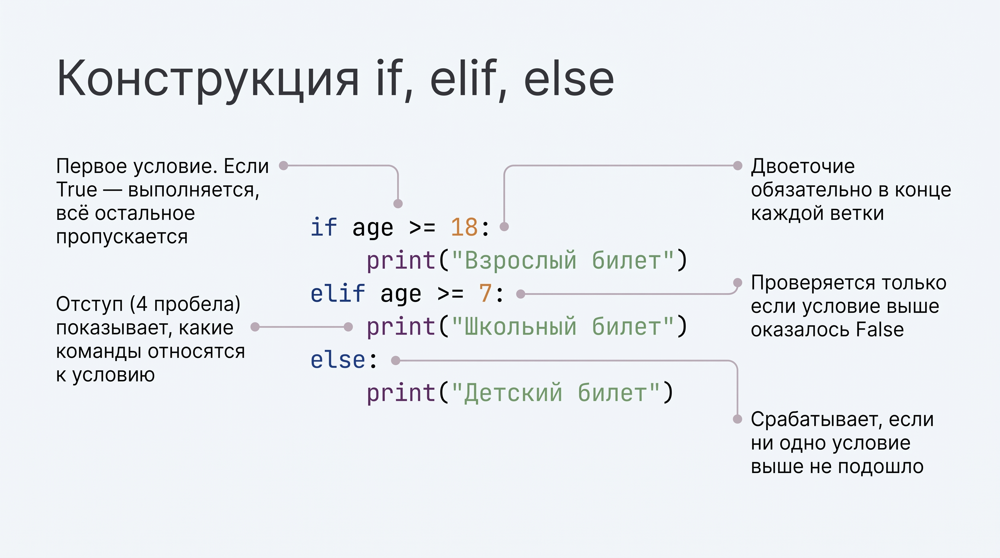
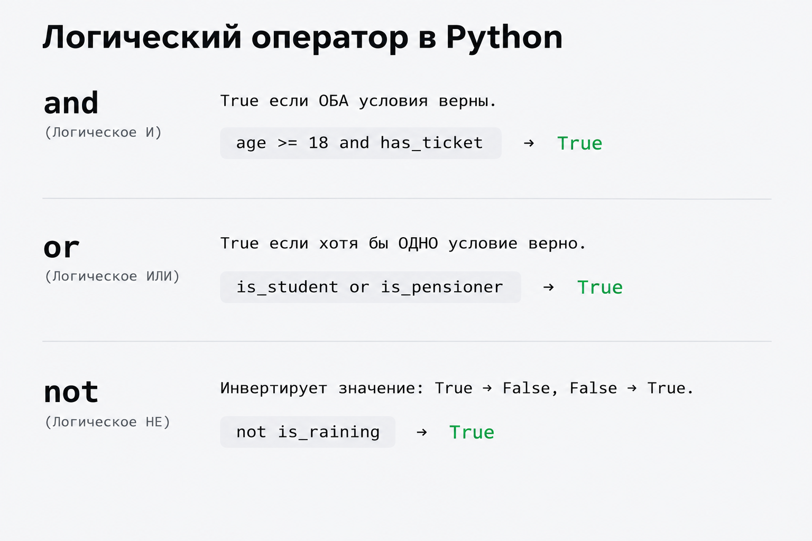

# Урок 4. Условия в Python: if, elif, else и логические операторы

На этом уроке вы научите программу принимать решения в зависимости от ситуации, познакомитесь с операторами сравнения и ветвлением кода, а также разберёте логические связки `and`, `or`, `not`.

## Цель урока

Освоить синтаксис условных конструкций (`if`, `elif`, `else`), понять важность отступов в Python, научиться сравнивать значения и строить сложные составные проверки с помощью логических операторов.

## План урока

1. Зачем нужны условия (как компьютер делает выбор)
2. Операторы сравнения: `==`, `!=`, `>`, `<`, `>=`, `<=`
3. Базовая конструкция `if` и `else` (двоеточие и отступы)
4. Множественный выбор: `elif`
5. Логические операторы: `and`, `or`, `not`
6. Разбор ошибок: блок «Найдите ошибку»

---

## 1. Зачем нужны условия

До сих пор наши программы выполнялись строго по одной линии: команда за командой сверху вниз. Но реальные программы должны уметь **выбирать**, как поступить:
- *Если* пароль верный — открыть доступ, *иначе* — показать ошибку.
- *Если* на улице дождь — взять зонт, *иначе* — идти налегке.
- *Если* на счету достаточно денег — совершить покупку, *иначе* — отказать в оплате.


---

## 2. Операторы сравнения

Чтобы проверить условие, значения нужно сравнить между собой. Результатом любого сравнения всегда является булево значение — **`True`** (истина) или **`False`** (ложь):




### 🎯 Практика 1: «Угадайте результат»
Не запуская код, ответьте, что выведет каждая строчка:
```python
print(15 > 10)
print(7 == "7")
print(20 != 20)
print(100 <= 100)
```
*Затем запустите код в терминале и проверьте себя.*

---

## 3. Базовая конструкция if и else

Ключевое слово **`if`** переводится как «если». 

### Синтаксис:
```python
age = 20

if age >= 18:
    print("Вам есть 18 лет.")
    print("Доступ к просмотру фильма разрешён.")
```

Обратите внимание на две важнейшие детали синтаксиса Python:
1. **Двоеточие `:`** ставится в конце строки с условием. Оно сообщает Python: «условие закончилось, дальше идёт блок действий».
2. **Отступ (4 пробела или Tab)**: все команды, которые должны выполниться при истинном условии, пишутся с отступом в 4 пробела.

### Ошибка IndentationError
Если забыть сделать отступ, программа завершится с ошибкой:
```python
if age >= 18:
print("Ошибка!")  # IndentationError: expected an indented block
```

### Блок else («иначе»)
Блок **`else`** выполняется в том случае, если условие в `if` оказалось ложным (`False`):

```python
age = 15

if age >= 18:
    print("Вход разрешён.")
else:
    print("Вам ещё нет 18 лет. Вход закрыт.")
```
Обратите внимание: после `else` условия не пишут, там ставится только двоеточие `:`.

### 🎯 Практика на уроке 2: «Проверка пароля»
Напишите программу:
1. Запросите у пользователя пароль через `input()`.
2. Если введённый пароль равен `"python123"`, выведите: `"Доступ открыт!"`.
3. Иначе выведите: `"Неверный пароль. Доступ заблокирован."`.

---

## 4. Множественный выбор: elif

Что делать, если вариантов не два («да» или «нет»), а больше? Для этого используют конструкцию **`elif`**




### Пример: Сигналы светофора
```python
signal = input("Введите цвет светофора (красный / желтый / зеленый): ")

if signal == "зеленый":
    print("Можно идти!")
elif signal == "желтый":
    print("Приготовьтесь.")
elif signal == "красный":
    print("Стой! Движение запрещено.")
else:
    print("Неизвестный сигнал светофора.")
```

### Как работает цепочка:
1. Python проверяет первое условие в `if`.
2. Если оно ложно, переходит к первому `elif`.
3. Как только **хотя бы одно** условие совпало, Python выполняет его блок и **сразу выходит** из всей конструкции, не проверяя остальные ветки.
4. Если ни одно условие не подошло, выполняется блок `else`.

### 🎯 Практика на уроке 3: «Оценка за тест»
Пользователь вводит количество баллов за тест от 0 до 100 (целое число через `int(input())`).
Напишите программу, которая выводит оценку:
- 90 баллов и выше — `"Отлично! Оценка 5"`
- 75–89 баллов — `"Хорошо! Оценка 4"`
- 60–74 балла — `"Удовлетворительно! Оценка 3"`
- Меньше 60 баллов — `"Тест не сдан. Оценка 2"`

---

## 5. Логические операторы: and, or, not

Иногда одного условия недостаточно — нужно проверить сразу несколько параметров. Для этого используются логические операторы:



### 1. Оператор `and` (логическое «И»)
Возвращает `True`, только если **оба** условия истинны одновременно:

```python
age = 22
has_ticket = True

if age >= 18 and has_ticket:
    print("Добро пожаловать на концерт!")
else:
    print("Вход невозможен.")
```
Если хотя бы одно условие окажется `False`, весь блок `and` вернёт `False`.

### 2. Оператор `or` (логическое «ИЛИ»)
Возвращает `True`, если хотя бы **одно** из условий истинно:

```python
is_student = True
is_pensioner = False

if is_student or is_pensioner:
    print("Вам положена скидка на проезд!")
else:
    print("Оплата по полному тарифу.")
```

### 3. Оператор `not` (логическое «НЕ»)
Инвертирует (переворачивает) значение: превращает `True` в `False`, а `False` — в `True`:

```python
is_raining = False

if not is_raining:
    print("На улице сухо, зонт не нужен.")
```

### 🎯 Практика на уроке 4: «Проверка диапазона»
Пользователь вводит число. Напишите условие, которое проверяет, находится ли число в диапазоне от `10` до `50` включительно, используя оператор `and`.

---

## 6. Разбор ошибок: блок «Найдите ошибку»

Посмотрите на три фрагмента кода. Найдите в каждом ошибку и объясните, почему Python откажется выполнять программу:

### Фрагмент 1:
```python
age = 18
if age >= 18
    print("Вы совершеннолетний")
```

### Фрагмент 2:
```python
score = 100
if score = 100:
    print("Максимальный балл!")
```

### Фрагмент 3:
```python
name = "Анна"
if name == "Анна":
print("Привет, Анна!")
```

---

## Домашка

Задания — в файле [homework.md](homework.md).
Код пишите у себя на компьютере в отдельном файле.
