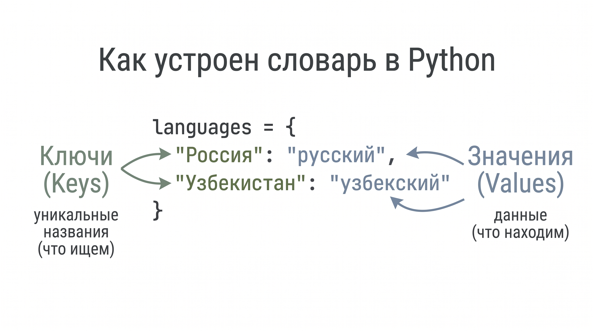

# Урок 6. Словари (dict)

В этом уроке мы с вами познакомимся с таким типом данных, как `dict`, а ещё его называют **словарём**. 

Почему, спросите вы? Да потому что он хранит данные в виде «ключа и значения». К примеру, если у вас есть опыт в изучении нового языка, то с большой вероятностью вы заводили себе тетрадь со словарём: слева писали само слово, справа — перевод этого слова. 

Так вот, в Python тип данных `dict` работает аналогичным способом — в виде пар «ключ: значение», где конкретное значение адресуется определённому ключу. Словари в Python в каком-то смысле похожи на списки (`list`), но отличаются тем, что хранят данные по совершенно другому принципу.

Теперь, когда мы узнали, что такое словарь (`dict`), давайте разберёмся: является ли он изменяемым или неизменяемым? Вы же помните эти две категории из прошлого урока? Надеюсь, что да 🙂‍↕️. 

Словари в Python являются **изменяемым** типом данных. Давайте вспомним, что это нам даёт!

В первую очередь это позволяет нам модифицировать содержимое словаря: добавлять, удалять и изменять элементы.

А теперь перейдём непосредственно к практике.

---

Как нам уже известно, тип данных `list` удобен тем, что в нём можно хранить множество данных в одной переменной. Также список автоматически нумерует каждый свой элемент индексами от `0` до `n`.

Давайте создадим список нескольких стран:

```python
countries = ["Россия", "Узбекистан", "Индия", "Египет"]

print(countries[0])
print(countries[1])
```

Отлично, с этим мы уже хорошо знакомы.

Допустим, мы также должны хранить язык, на котором говорят в каждой стране. Это можно реализовать несколькими способами.

### Способ 1
Создать ещё один параллельный список, где по соответствующему индексу будут храниться языки этих стран:

```python
countries = ["Россия", "Узбекистан", "Индия", "Египет"]
languages = ["русский", "узбекский", "хинди", "арабский"]

print(f"Страна: {countries[0]}, язык: {languages[0]}")
```

Вышепоказанный способ рабочий, но не слишком удобный: в параллельных индексах легко запутаться и допустить ошибку со сдвигом.

### Способ 2
Хранить единый список кортежей. Внутри каждого кортежа будут лежать два элемента:
1. Сама страна;
2. Государственный язык.

```python
languages = [
    ("Россия", "русский"),
    ("Узбекистан", "узбекский"),
    ("Индия", "хинди"),
    ("Египет", "арабский")
]

print(languages[0][1])
```

Кажется, мы решили проблему, и теперь всё выглядит структурированно. Но это всё ещё неэффективный способ хранения таких данных!

К примеру, чтобы проверить, где живёт человек, и узнать его родной язык: чтобы проверить, есть ли такая страна в нашей базе, программе придётся пробежаться от начала списка и до самого конца. При больших объёмах данных это времязатратно и неэффективно.

---

### Решение задачи с помощью словарей (dict)

Словари в Python создаются с помощью фигурных скобок `{}`. Внутри мы храним пары вида `ключ: значение`, разделённые двоеточием `:`:

```python
languages = {
    "Россия": "русский",
    "Узбекистан": "узбекский",
    "Индия": "хинди",
    "Египет": "арабский"
}
```

В качестве **ключа** (слева от двоеточия `:`) мы указали страну, а в качестве **значения** (справа от двоеточия `:`) — язык соответствующей страны.

База данных готова! Но в чём принципиальная разница между списком и словарём?

Разница в том, что словари позволяют **мгновенно извлекать значение (`value`) по его ключу**. В словарях нет традиционной числовой индексации (`0, 1, 2...`), как в списках (`list`). Тем самым тип данных `dict` принципиально отличается от `list` способом хранения и поиска данных.

Но это не значит, что мы теперь откажемся от списков. Ни в коем случае! Мы будем подбирать подходящий инструмент под конкретные задачи: и у списков, и у словарей есть свои суперспособности.




---

## Основные операции со словарём

Давайте попробуем использовать операторы `in` и `not in`. 

Представьте, что перед нами задача:

```python
capitals = {
    'Россия': 'Москва', 
    'Франция': 'Париж', 
    'Чехия': 'Прага'
}

user_country = input("Введите страну: ")
```

Наша задача — вывести пользователю столицу его страны, **но только в том случае, если она существует в нашей базе данных**. 

И тут на помощь как раз приходит оператор `in`: он проверяет, содержится ли такой ключ в словаре:

```python
capitals = {
    'Россия': 'Москва', 
    'Франция': 'Париж', 
    'Чехия': 'Прага'
}

user_country = input("Введите страну: ")

if user_country in capitals:
    print(f"Столица вашей страны: {capitals[user_country]}")
```

### 🎯 Практика на уроке: проверка страны
Подумайте вот над чем: если пользователь введёт несуществующую страну, вежливо предупредите его, что такой страны нет на планете Земля 🌍. 

*Требование*: решите задачу с помощью оператора `not in` — без использования `else`!

---

## Методы и операции со словарём

Подробный разбор и примеры работы с методами (`.get()`, `.pop()`, `.keys()`, `.values()`, `.items()`) вынесены в отдельный справочник:
👉 **[methods.md](methods.md)**

---

## Домашка

Задания — в файле [homework.md](homework.md).
Код пишите у себя на компьютере в отдельном файле.